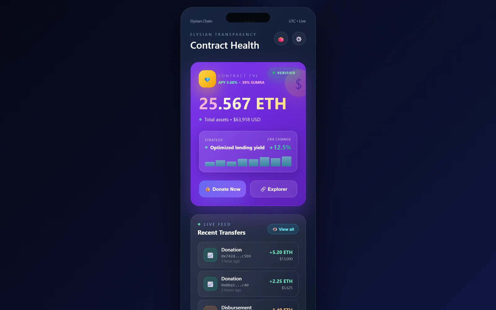
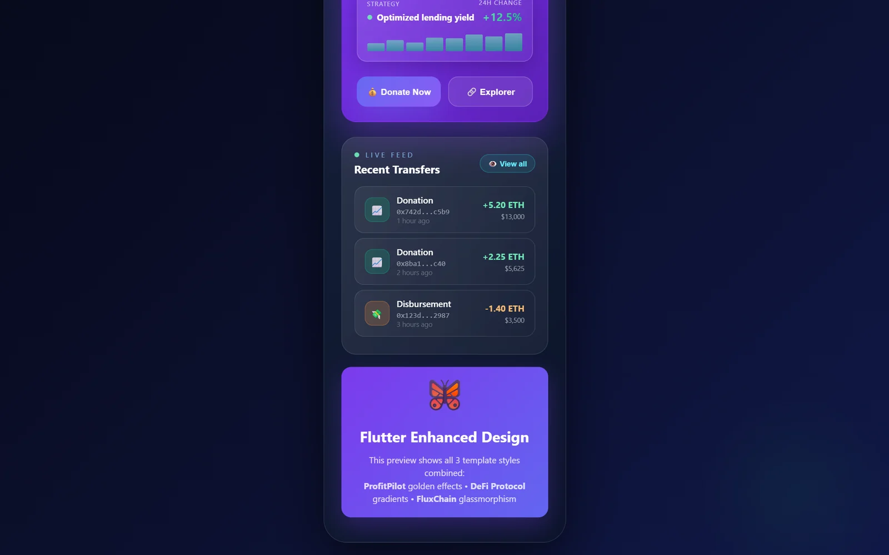

<div align="center">

# Elysian: Charity Donation Transparency

**A blockchain charity platform where every donation, NGO verification and withdrawal is a public, verifiable transaction.**

Team Reverse Engineering · Smart contract + Next.js web app + Flutter mobile app


</div>

## The problem

Donors rarely see where their money goes after it leaves their account. Elysian puts the whole flow on Ethereum: donations go into a smart contract, only NGOs verified by the owner can withdraw, and every movement is an on-chain event anyone can audit.

## Screens

<table>
  <tr>
    <td width="50%"></td>
    <td width="50%" align="center"></td>
  </tr>
  <tr>
    <td><b>Live feed.</b> Recent donations and disbursements with amounts and addresses, plus Donate and Etherscan links.</td>
    <td><b>Mobile web.</b> The same dashboard at phone width.</td>
  </tr>
  <tr>
    <td></td>
    <td></td>
  </tr>
  <tr>
    <td colspan="2"><b>Flutter app design preview</b> (<code>FLUTTER_DEMO.html</code>): the mobile app's contract health and recent transfers screens.</td>
  </tr>
</table>

## Smart contract

`contracts/ElysianCharity.sol` (Solidity 0.8.20, OpenZeppelin v5 `Ownable` and `ReentrancyGuard`):

| Function | Who | What it does |
|---|---|---|
| `donate()` | anyone | Send ETH to the pool; emits `DonationReceived` |
| `registerNGO()` / `removeNGO()` | owner | Verify or remove an NGO address; emits `NGOVerified` / `NGORemoved` |
| `withdrawFunds()` | owner | Release funds to a verified NGO; emits `FundsWithdrawn` |
| `emergencyWithdraw()` | owner | Pull all funds in an emergency |
| `getDonationStats()`, `getVerifiedNGOs()`, `getDonorContribution()`, `getNGOWithdrawals()` | anyone | Read-only views for the dashboards |

## Web app

Next.js 14, TypeScript, Tailwind CSS, ethers.js v6.

- **Wallet**: MetaMask connection, with an install guide when MetaMask is missing.
- **Donate**: amount input with quick amounts (0.1, 0.5, 1.0 ETH), validation and notifications.
- **Admin panel**: owner-only NGO registration, fund withdrawal and emergency controls.
- **Transaction ledger**: on-chain events with filtering, CSV export and Etherscan links.

## Mobile app

`flutter_app/` is a Flutter app (web3dart, flutter_animate) for the same contract. Note: it currently does not compile, because `lib/screens/tokenomics_page.dart` and `lib/widgets/landing/tokenomics_section.dart` are imported but not in the repository.

## Run locally

```bash
# contracts
npm install
npx hardhat compile
npx hardhat test
npx hardhat node                    # local chain on localhost:8545
node scripts/simple-deploy.cjs      # new terminal: deploy the contract

# web app
cd frontend
npm install
# frontend/.env.local:
#   NEXT_PUBLIC_CONTRACT_ADDRESS=<address printed by the deploy script>
#   NEXT_PUBLIC_OWNER_ADDRESS, NEXT_PUBLIC_NETWORK_NAME, NEXT_PUBLIC_BLOCK_EXPLORER
npm run dev                         # http://localhost:3000
```

## Project structure

```
contracts/       ElysianCharity.sol
scripts/         deploy scripts
test/            Hardhat tests
frontend/        Next.js web app (components: ElysianDashboard, DonationForm, AdminPanel, TransactionLedger, ...)
flutter_app/     Flutter mobile app
```
